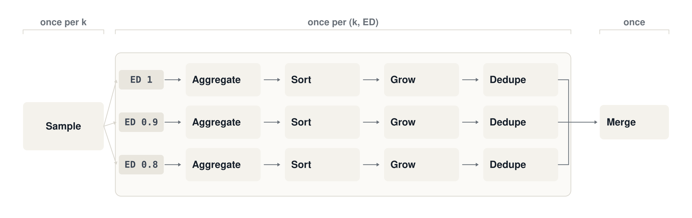
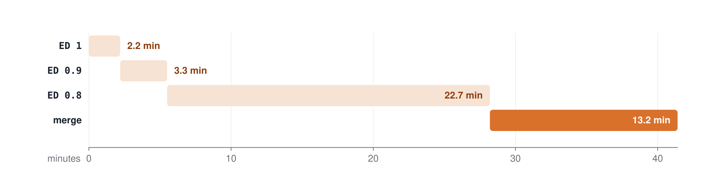
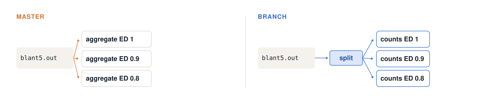
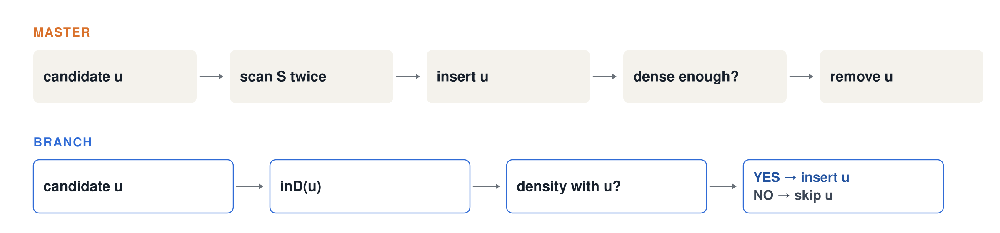
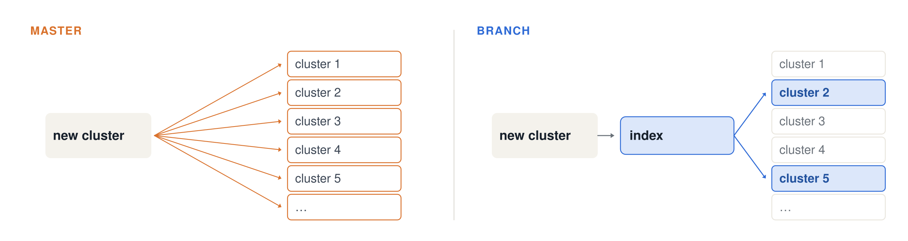
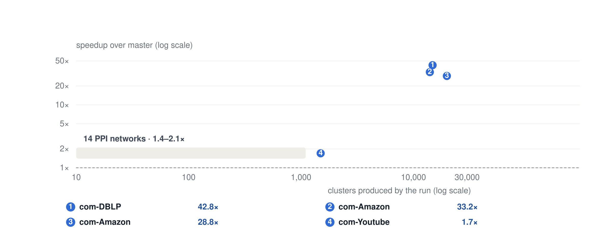

# Optimizing blant-clusters.sh

Oct 29, 2026

## Abstract

The optimized `blant-clusters.sh` script produces output identical to original. It is 1.4-2.1x faster on the 14 PPI networks of the lab, and 29-43x faster on million-edge SNAP graphs like com-DBLP. The improvement stems from eliminating duplicate work from the clustering procedure, and substituting the all-pairs de-duplication/merging with a hashing function and inverted index. The concurrency and maximum memory requirements are the same as the master. 

## 1. Background

`scripts/blant-clusters.sh` turns BLANT graphlet samples into dense communities. For every graphlet size k and edge-density threshold ED, it runs a pipeline of awk and sort stages, then merges the clusters from all (k, ED) pairs into one list.

Sampling is performed once for each k. First, `blant -mcg` generates one line per (node, canonical graphlet) as `count<TAB>neighbors of u`, where the neighbors are the nodes that cooccur with u in the sampled graphlets of that kind. The four middle stages are performed once for each (k, ED) combination. An awk retains the graphlet kinds having at least ED×C(k,2) edges and outputs `count u item neighbors`; `sort -gr` arranges the lines in order of counts, in descending order, such that the line number is the priority for BFS seed node. The build awk loads the graph and tries building the cluster S from the top ED×#(lines) seeds using the greedy BFS on the graphlet neighbor graph, taking a node u as an element if S+u has a density of at least ED×leeway. Pruning the nodes with unusually low in-cluster degree until density≥ED is satisfied, it outputs the clusters passing minClus and edge-mean criteria. Exact duplicates are eliminated per (k, ED).

The merge runs once over all (k, ED) outputs. They are merge-sorted by size, and a cluster is kept only if it overlaps no earlier cluster by more than `OVERLAP` (default 0.5) of its nodes.

All of this is in gawk, through the lab's `hawk` wrapper, which prepends `libwayne/bin/misc.awk`. The BFS randomizes its queue order with `misc.awk`'s `randsort` comparator, so a run is reproducible only for a fixed `-r` seed.

**Figure 1** — The pipeline. Sampling runs once per k; the four middle stages run once per (k, ED) pair, which is nine pipelines for k = 4–6 and ED = 1, 0.9, 0.8; the merge runs once, over all nine cluster lists.

## 2. Challenge

The old script spends most of its time redoing work it has already done, and its stages run one ED at a time. The cost concentrates in five places:

| Where                    | What master does                                                                                                                                                                      | Cost                                                         |
| ------------------------ | ------------------------------------------------------------------------------------------------------------------------------------------------------------------------------------- | ------------------------------------------------------------ |
| BFS candidate test       | `EdgesIntoS(u)` and `WgtEdgesIntoS(u)` each loop over all of S. u is inserted into S first and deleted again if rejected.                                                             | 2·\|S\| per candidate, and most candidates are rejected      |
| Pruning and stripping    | `InducedEdges(edge, S, degreeInS)` recounts every in-cluster edge after pruning, after every single strip, and again at acceptance, only to `ASSERT` that it equals the running count | O(Σ deg) per call, once per stripped node                    |
| Queue append             | `PROCINFO["sorted_in"]="randsort"` sorts a node's entire graphlet-neighbor list with an awk comparator, filtering only during the loop                                                | O(d log d) awk function calls per accepted node              |
| Aggregation              | Re-reads each BLANT file once per ED and holds every (node, item, neighbor) triple in a 3-level array before printing                                                                 | One BLANT pass per ED; about 2 GB of RAM per k on com-Amazon |
| De-duplication and merge | Compares each new cluster with every previous cluster                                                                                                                                 | O(numClus² · \|S\|)                                          |

**Figure 2** — Where master's 41.4 minutes go on com-Amazon: k = 4, one default `-p0.9L` sample, EDs one after another. ED 0.8 takes 22.7 min because it keeps 26,138 clusters, and the merge then checks all 41,227 clusters against each other.

## 3. Approach

Every change below keeps the old script's output. Section 4 explains how. All changes are in `scripts/blant-clusters.sh`.

### 3.1 Pipeline: read each sample file once, stream instead of accumulating

The branch creates one subshell for each k. The aggregation awk script reads `blant$k.out` only once and forwards each line to the counts file for each ED for which the minimum number of edges in the graphlet condition is met; earlier, master would re-read and re-aggregate this file for each ED. Each pair of (node, item) is output only once by BLANT (proved now), hence each line can be forwarded immediately as and when it is read.

`export LC_ALL=C` makes `sort` run about 10× faster than UTF-8 collation here, and for this ASCII data it gives the same order as the `C.UTF-8` locale. `getline` loops read the BLANT output and the sorted counts, skipping `misc.awk`'s per-record DOS check on files the script wrote itself. The network's node and edge counts are taken while loading the edge list, instead of in a separate `hawk` pass.

**Figure 3** — One read per sample file. Master re-reads and re-aggregates the same file once per ED. The branch reads it once and copies each line to the counts file of every ED whose minimum edge count the graphlet meets.

### 3.2 Cluster growth: stop recounting

`inD(v)` replaces `EdgesIntoS` and `WgtEdgesIntoS`. It computes v's in-cluster degree and weight in one pass over the shorter of v's adjacency list and the member list, and when the graph is symmetric, unweighted and loop-free, it takes a fast path with no symmetry checks. A candidate is judged by (edgeCount + hits) / C(|S|+1, 2) before it is added, so the common case, rejection, never touches S.

The member list is dense: `SL[1..Slen]` with a position index `SI` gives O(1) add and swap-remove, and its numeric-index loops run about 1.8× faster than `for-in`. A flat-array BFS queue replaces `misc.awk`'s `Queue*` functions, and graphlet-neighbor rows are built through sub-array parameters, which gawk indexes faster.

`edgeCount` and `wgtEdgeCount` are maintained incrementally, so in-cluster degrees come from one `InducedEdges` call before pruning and one before stripping, with the second skipped when pruning removed nobody. Master made one call per stripped node, plus one more at acceptance; the remaining calls stay because of the order they insert keys in (Section 4). The per-cluster statistics loop at acceptance, whose results were never printed, is gone.

Constants are hoisted: the `highRelClusCount` threshold √ED·0.9, ED × leeway, the pruning mean and standard deviation, and k(k−1)/2 in place of `choose()`. The old recounts doubled as consistency asserts (zero weights, self-loops, one-sided edges); those cases are now detected while loading and checked at the same points, and the check costs nothing on clean input.

**Figure 4** — Judge a candidate before touching S. Master scans S twice for every candidate, once for edges and once for weights, and inserts u first so that most of that work ends in a delete. The branch computes u's in-cluster degree in one pass over the shorter of adj(u) and S, and tests density before the insert.

### 3.3 De-duplication and merge

Duplicates are found using hashing of the sorted list of each cluster’s members, `O(|S|log |S|)` per cluster instead of `O(numClus · |S|)`, where the input comes in reverse size order, so any previous cluster containing S has to be identical to S. In the case of the overlap filter, since we have an index of cluster membership by node, we can compare only to previous clusters having a common node.

**Figure 5** — Only clusters that share a node can overlap. Master compares each new cluster with every earlier one. The branch looks the new cluster's nodes up in an inverted index and compares it only with the clusters recorded there; no other cluster can exceed the overlap threshold.

## 4. Evaluation setup

Both versions read the same BLANT output files (`-D`), so the timings cover the clustering script alone. Every run uses ED = 1, 0.9, 0.8 and default options otherwise.

| Set | Networks | Size | k | BLANT sampling | Seeds |
| --- | --- | --- | --- | --- | --- |
| Small | the 14 edge lists in `networks/`, OCD-vs-CONTROL through HSapiens | 2K–111K edges | 4, 5, 6 | `-p0.9L` (the script's default), EBE | 3 per version |
| Large | SNAP [com-Amazon](https://snap.stanford.edu/data/com-Amazon.html), [com-DBLP](https://snap.stanford.edu/data/com-DBLP.html), [com-Youtube](https://snap.stanford.edu/data/com-Youtube.html) | 0.93M, 1.05M, 2.99M edges | 5; also 4–6 for com-Amazon | `-n` 1M samples (3M for Youtube), EBE | 1 per version |

## 5. Results

The branch is 1.4–2.1× faster on the lab's PPI networks and 29–43× faster on million-edge graphs that produce thousands of clusters. Output was identical to master in all 46 runs.

**Figure 6** — Speedup over master, on the same BLANT samples and seed. Benchmarks run 2026-10-29 on an Apple M1, 8 GB. Small networks: k = 4–6, median of 3 seeds. SNAP graphs: k = 5, 1 seed.

What influences the gain is not the number of edges but the number of clusters. In Master's dedupe and final merge, each new cluster is compared to all existing clusters, so that the time required for this process increases quadratically with the number of clusters. The graph com-Youtube is the biggest one but has the smallest number of clusters - only 1,494. The gain of 1.7× is achieved only through the growth of the number of clusters.

| Network | k | Edges | Clusters | master | branch | Memory headroom (master / branch) |
| --- | --- | --- | --- | --- | --- | --- |
| com-DBLP | 5 | 1,049,866 | 14,796 | 41.8 min | 58.5 s | 62% / 62% |
| com-Amazon | 5 | 925,872 | 13,988 | 34.5 min | 62.3 s | 60% / 59% |
| com-Amazon | 4–6 | 925,872 | 19,821 | 64.1 min | 133.7 s | 43% / 46% |
| com-Youtube | 5 | 2,987,624 | 1,494 | 60.7 s | 35.9 s | 62% / 63% |

Memory headroom is the lowest share of RAM macOS reported as available during the run (`kern.memorystatus_level`). The two versions run the same number of community-building awks at a time, so they need the same memory.